# Checkpoint order

A checkpoint can start when every checkpoint in its needs list is done. Same wave means they can
run in parallel.

Owners: 🟪 Rudra · 🟩 HK · 🟧 Ash

```mermaid
flowchart TB
    subgraph W1["Wave 1"]
        CP1["<b>CP1 Virtual clock</b><br/>Rudra<br/>needs: nothing"]:::rudra
        CP3["<b>CP3 Seed streams</b><br/>Rudra<br/>needs: nothing"]:::rudra
        CP7["<b>CP7 Protocol spec</b><br/>Ash<br/>needs: nothing"]:::ash
    end

    subgraph W2["Wave 2"]
        CP2["<b>CP2 Event queue</b><br/>HK<br/>needs: CP1"]:::hk
        CP8["<b>CP8 Process driver</b><br/>Ash<br/>needs: CP7"]:::ash
    end

    subgraph W3["Wave 3"]
        CP4["<b>CP4 Main loop</b><br/>HK<br/>needs: CP2"]:::hk
    end

    subgraph W4["Wave 4"]
        CP5["<b>CP5 Trace and hash</b><br/>Rudra<br/>needs: CP4"]:::rudra
        CP6["<b>CP6 Simulated network</b><br/>Rudra<br/>needs: CP2, CP3, CP4"]:::rudra
        CP9["<b>CP9 Capitulum</b><br/>Ash<br/>needs: CP4, CP8"]:::ash
    end

    subgraph W5["Wave 5"]
        CP10["<b>CP10 Timers</b><br/>Ash<br/>needs: CP9"]:::ash
        CP11["<b>CP11 Crash storage</b><br/>Ash<br/>needs: CP9"]:::ash
        CP12["<b>CP12 Check-determinism</b><br/>Ash<br/>needs: CP5, CP9"]:::ash
        CP13["<b>CP13 Config</b><br/>Rudra<br/>needs: CP7, CP9"]:::rudra
        CP22["<b>CP22 Second floret</b><br/>Ash<br/>needs: CP9"]:::ash
    end

    subgraph W6["Wave 6"]
        CP14["<b>CP14 Fault rules</b><br/>Rudra<br/>needs: CP6, CP13"]:::rudra
        CP16["<b>CP16 Workload</b><br/>HK<br/>needs: CP4, CP13"]:::hk
        CP17["<b>CP17 kvnode floret</b><br/>HK<br/>needs: CP10, CP11"]:::hk
    end

    subgraph W7["Wave 7"]
        CP15["<b>CP15 Crash + partition</b><br/>Ash<br/>needs: CP11, CP14"]:::ash
        CP18["<b>CP18 Acked-writes checker</b><br/>HK<br/>needs: CP16, CP17"]:::hk
        CP21["<b>CP21 Linearizability</b><br/>HK<br/>needs: CP16"]:::hk
    end

    subgraph W8["Wave 8"]
        CP19["<b>CP19 Pappus + sweep</b><br/>Rudra<br/>needs: CP5, CP14, CP18"]:::rudra
    end

    subgraph W9["Wave 9"]
        CP20["<b>CP20 Parallel sweep</b><br/>Rudra<br/>needs: CP19"]:::rudra
    end

    subgraph W10["Wave 10"]
        CP24["<b>CP24 Coordinator + workers</b><br/>Rudra<br/>needs: CP20"]:::rudra
    end

    subgraph W11["Wave 11"]
        CP23["<b>CP23 Docs + release</b><br/>HK<br/>needs: CP20, CP21, CP22, CP24"]:::hk
    end

    W1 ~~~ W2 ~~~ W3 ~~~ W4 ~~~ W5 ~~~ W6 ~~~ W7 ~~~ W8 ~~~ W9 ~~~ W10 ~~~ W11

    classDef rudra fill:#CFCBF5,stroke:#5B4FC4,color:#1F1A4D
    classDef hk fill:#A0E1CB,stroke:#1A7457,color:#0B3326
    classDef ash fill:#F5C4B3,stroke:#A33B1C,color:#4A1608
```

CP12, CP15, CP21, and CP22 feed only the release, so they can move if a wave runs late.

## As a table

| Wave | Checkpoint | Owner | Needs |
|---|---|---|---|
| 1 | CP1 Virtual clock | Rudra | nothing |
| 1 | CP3 Seed streams | Rudra | nothing |
| 1 | CP7 Protocol spec | Ash | nothing |
| 2 | CP2 Event queue | HK | CP1 |
| 2 | CP8 Process driver | Ash | CP7 |
| 3 | CP4 Main loop | HK | CP2 |
| 4 | CP5 Trace and hash | Rudra | CP4 |
| 4 | CP6 Simulated network | Rudra | CP2, CP3, CP4 |
| 4 | CP9 Capitulum | Ash | CP4, CP8 |
| 5 | CP10 Timers | Ash | CP9 |
| 5 | CP11 Crash storage | Ash | CP9 |
| 5 | CP12 Check-determinism | Ash | CP5, CP9 |
| 5 | CP13 Config | Rudra | CP7, CP9 |
| 5 | CP22 Second floret | Ash | CP9 |
| 6 | CP14 Fault rules | Rudra | CP6, CP13 |
| 6 | CP16 Workload | HK | CP4, CP13 |
| 6 | CP17 kvnode floret | HK | CP10, CP11 |
| 7 | CP15 Crash + partition | Ash | CP11, CP14 |
| 7 | CP18 Acked-writes checker | HK | CP16, CP17 |
| 7 | CP21 Linearizability | HK | CP16 |
| 8 | CP19 Pappus + sweep | Rudra | CP5, CP14, CP18 |
| 9 | CP20 Parallel sweep | Rudra | CP19 |
| 10 | CP24 Coordinator + workers | Rudra | CP20 |
| 11 | CP23 Docs + release | HK | CP20, CP21, CP22, CP24 |
